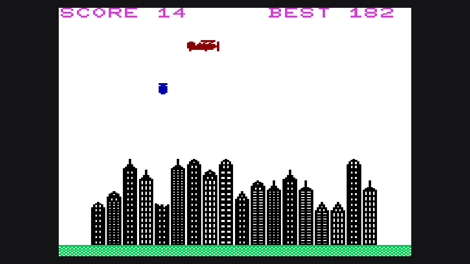

# VIC-20 Blitz (1981) — Native macOS & Windows Ports

A 100% native reverse-engineered recreation of the legendary 1981 Commodore VIC-20 classic **Blitz** (written by Simon N. Taylor, published by Commodore UK / Taysoft).

<p align="center">
  
</p>

This repository contains two completely native, standalone ports with **zero emulators** required:
* **macOS (AppKit / Swift)**: Runs on Apple Silicon (arm64) and Intel (x86_64) Macs. Pre-built bundle: [`macOS/VIC Blitz.app`](macOS/VIC%20Blitz.app).
* **Windows (Win32 / C)**: Pure native 64-bit Windows GUI executable with GDI graphics and WaveOut audio. Pre-built executable: [`Windows/VIC_Blitz.exe`](Windows/VIC_Blitz.exe).

---

## Features & Authenticity

* **Exact VIC-20 Visuals**: Authentic 22×23 character matrix with the characteristic 1.48:1 CRT non-square pixel aspect ratio.
* **Original 8×8 Custom Bitmaps**: Extracted directly from the original `blitz.prg` binary:
  - 5 building floor styles with windows
  - 5 damaged floor variations
  - 5 decorative roof spires
  - Textured green ground line
  - Red 2-character biplane with animated propeller
  - Falling bomb with stabilization fins
  - Animated walking pilot celebration sequence
  - Impact craters and falling crash debris
* **Commodore Character Generator ROM**: Authentic Commodore VIC-20 ROM typography for the title screen, instructions, HUD, and high-score screens.
* **Authentic VIC-I (MOS 6561) Audio**:
  - **Biplane Engine Hum**: 16-bit pseudo-random noise toggling between 364.6 Hz and 272.7 Hz, reproducing the low-frequency mechanical engine chug.
  - **5-Row Floor Penetration Drill**: Voice 2 square-wave synthesizer using Simon Taylor's exact formula `254 - f*20`, producing rising staccato beeps (~85 Hz → ~107 Hz → ~142 Hz → ~211 Hz → ~412 Hz) as the bomb drills down through the city.
  - **Crash Explosion**: Noise burst at ~989.6 Hz with screen shake and linear volume decay.
  - **Landing Fanfare**: Victory engine ramp and celebratory chimes.
* **Mathematically Achievable Progression**: Level 1 skyline generation is calibrated so that every generated layout is 100% completable. Clearing a level lands the plane on Runway Row 21, awards a 20% score bonus, and advances to the next frame with progressive difficulty.
* **Keyboard Controls**:
  - <kbd>Space</kbd> / <kbd>Return</kbd> / <kbd>Down Arrow</kbd> / <kbd>F1</kbd>: Drop bomb / Start game
  - <kbd>Esc</kbd>: Exit to Title Menu
  - <kbd>M</kbd>: Toggle between Full Color and Monochrome Green/Black modes
  - <kbd>+</kbd> / <kbd>-</kbd>: Adjust game speed in real time

---

## Repository Structure

```
.
├── README.md               # Project documentation
│
├── macOS/                  # Native macOS AppKit/Swift Port
│   ├── VIC Blitz.app       # Pre-built standalone macOS application bundle
│   ├── main.swift          # AppKit delegate, event handling, and game loop
│   ├── BlitzGame.swift     # Complete game state machine, physics & rules
│   ├── BlitzView.swift     # Custom NSView with CRT aspect ratio & character blitter
│   ├── BlitzAudio.swift    # Low-latency AVAudioEngine real-time audio mixer
│   ├── AudioData.swift     # Embedded PCM audio buffers (22,050 Hz)
│   ├── FontData.swift      # 256 Commodore ROM glyphs + 32 custom game sprites
│   ├── Info.plist          # macOS bundle configuration
│   ├── AppIcon.icns        # High-res retro macOS application icon
│   └── build.sh            # One-command macOS build script
│
├── Windows/                # Native Windows Win32/C Port
│   ├── VIC_Blitz.exe       # Pre-built standalone 64-bit Windows executable
│   ├── main.c              # Pure Win32 C implementation (GDI + WaveOut)
│   ├── font_data.h         # Extracted 8x8 ROM glyphs and custom sprites
│   ├── audio_data.h        # Embedded PCM audio buffers
│   ├── resource.rc         # Windows application icon and version metadata
│   ├── app.ico             # Windows multi-resolution icon (16x16 to 256x256)
│   ├── build.sh            # MinGW-w64 cross-compilation script (macOS/Linux)
│   └── build.bat           # Windows command prompt build script (GCC/MinGW)
│
└── tools/                  # Reverse-Engineering Utilities
    ├── blitz.prg           # Original 1981 Commodore VIC-20 PRG tape dump
    ├── analyze_prg.py      # Tape structure analysis & sprite extractor
    └── disasm.py           # 6502 disassembler utility
```

---

## How to Build & Run

### macOS

#### Pre-Built App
Double-click `macOS/VIC Blitz.app` or run:
```bash
open "macOS/VIC Blitz.app"
```

#### Compiling from Source
Requires Xcode Command Line Tools (`xcode-select --install`):
```bash
cd macOS
./build.sh
open "VIC Blitz.app"
```

---

### Windows

#### Pre-Built Executable
Run `Windows/VIC_Blitz.exe` directly on any 64-bit Windows PC (Windows 7, 8, 10, 11). No install, no runtime, no external DLLs needed.

#### Compiling from Source on Windows (MinGW / GCC)
```cmd
cd Windows
build.bat
```

#### Cross-Compiling for Windows on macOS / Linux (MinGW-w64)
```bash
# On macOS: brew install mingw-w64
cd Windows
./build.sh
```

---

## Reverse-Engineering Highlights

1. **Tape Extraction (`blitz.prg`)**:
   Extracted from original tape timings into a 3,569-byte binary with load address `$1001` (4097 decimal, VIC-20 BASIC RAM start for an unexpanded 5KB machine).
2. **Decompilation**:
   Reconstructed all 65 lines of BASIC V2 and embedded machine code routines, extracting Simon Taylor's original screen RAM offsets, Voice 2 drill formulas (`254 - f*20`), and screen shake logic (`poke 36865, rnd(3)+38 : poke 36864, rnd(3)+12`).
3. **ROM vs. RAM Glyph Separation**:
   In the original game, `$9005` was toggled between character ROM mode (menus) and RAM sprite mode (gameplay). Both the macOS and Windows ports cleanly resolve this by separating the 256-glyph Commodore ROM font from the 32 in-game custom 8×8 sprites.
4. **5-Row Drilling Physics**:
   A bomb does not just delete one cell; it drills downward through up to 5 floors, escalating in pitch with each floor penetrated, before leaving a damaged floor remnant on the 6th floor.

---

## License & Credits

* Original 1981 game by **Simon N. Taylor**, published by **Commodore UK / Taysoft**.
* Reverse-engineered, modernized, and ported natively for macOS and Windows.
